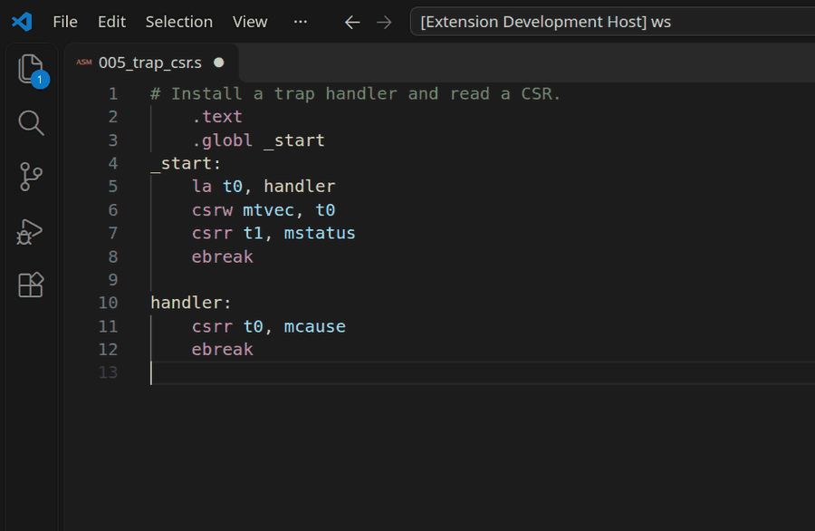
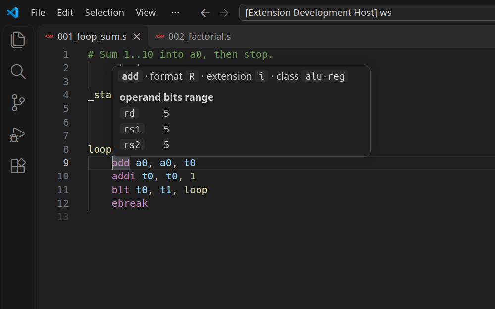
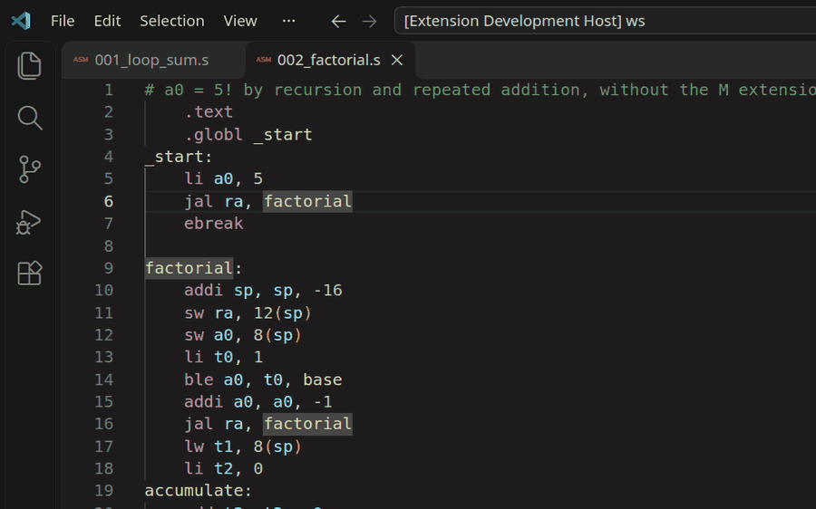
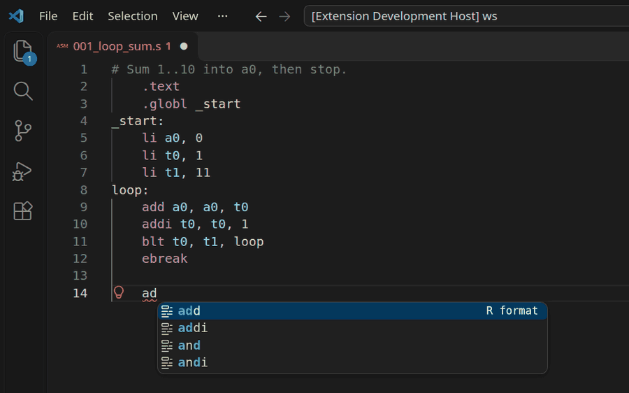
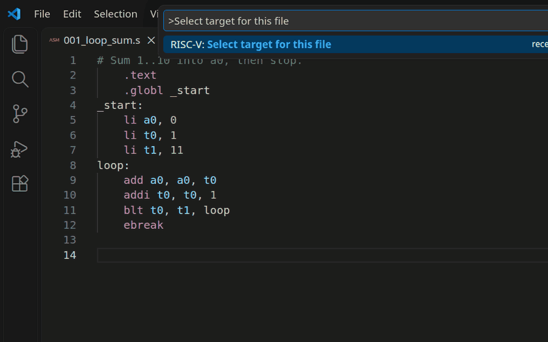
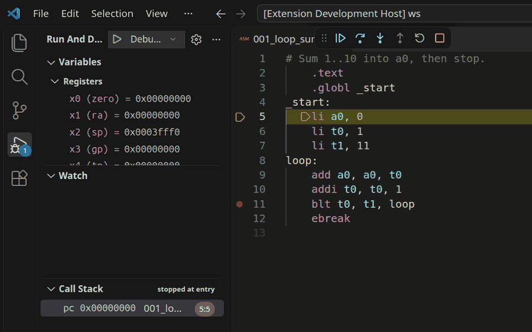
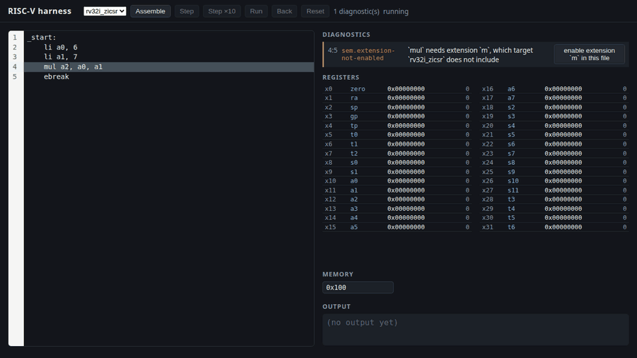

# RISC-V harness

One machine-readable ISA description and one semantic core, shared by a browser
playground, a language server, a simulator and a debug adapter.

The point of the project is that the editor, the debugger and the playground run
the *same* assembler and the *same* simulator, so what the editor says is legal is
what runs, and what runs is what the page shows.

## Demos

### 1. A diagnostic, and the fix

`mul` is not part of this file's target. The light bulb offers the one-line
declaration that makes it legal.



### 2. Hover

The encoding table comes from `isa/*.toml`, not from a table written twice.



### 3. Go to definition

F12 on `factorial` jumps to the label, and the client marks both ends of the jump.



### 4. Completion

Type `ad`, and the list holds only instructions the current target allows, with
their encoding format.



### 5. Switch the target

A file can declare its own target; this picker is for the files that do not.



### 6. Debug

Breakpoints are lines with instructions; `next` is one instruction. The session
stops at entry, continues to the breakpoint, then steps.



### 7. The playground

The same core in a browser, for readers who do not have an editor yet. It is
deployed at <https://trislu.github.io/risc-v-harness/>; nothing to install.



## Status

Pre-release, `0.x`. What works today:

- 141 instructions: RV32I, Zicsr, M, A, C, F and D; a file declares its own target
  with `.attribute arch` or `.option arch`
- `.insn` for raw words, board presets, and a trace that agrees with spike step by
  step (`scripts/verify-trace.sh`)
- assembler, simulator with undo and trace, ELF reading and writing
- language server: pull diagnostics with fixes, hover, completion, definition,
  semantic tokens; debug adapter with breakpoints and a memory view
- VS Code extension and a Svelte playground, both over the same wasm core

Not implemented yet: `rv64*` bases, the upstream ISA importer, and the Q
extension. The [plan](docs/plan.md) keeps the full list.

## Quick start

```bash
cargo run -p rvh-cli -- run tests/corpus/002_factorial.s
cargo run -p rvh-cli -- hover tests/corpus/001_loop_sum.s 9 5
cargo run -p rvh-cli -- lsp          # speak LSP on stdin/stdout
pnpm install && pnpm wasm && pnpm dev   # playground at http://localhost:5173
```

No external dependencies: every crate builds with a bare toolchain. The same
playground is hosted at <https://trislu.github.io/risc-v-harness/>.

## Where to look

| document | what it answers |
| --- | --- |
| [docs/plan.md](docs/plan.md) | why the project exists, milestones, open questions |
| [docs/architecture.md](docs/architecture.md) | layers, crate graph, data flow, testing gates |
| [docs/usage.md](docs/usage.md) | CLI, LSP, DAP, VS Code extension, playground |
| [docs/development.md](docs/development.md) | build, codegen, snapshots, differential checks |
| [docs/adr/](docs/adr/README.md) | one record per decision, 0001–0017 |
| [tests/corpus/README.md](tests/corpus/README.md) | the numbered examples and what each teaches |
| [CHANGELOG.md](CHANGELOG.md) | what this version contains, and what it does not |

## License

Code is `MIT OR Apache-2.0`: pick either. Documentation, lesson text and the
content overlay are `CC-BY-4.0`. `THIRD_PARTY.md` lists every source, and
[ADR-0007](docs/adr/0007-repo-shape.md) records the split.
