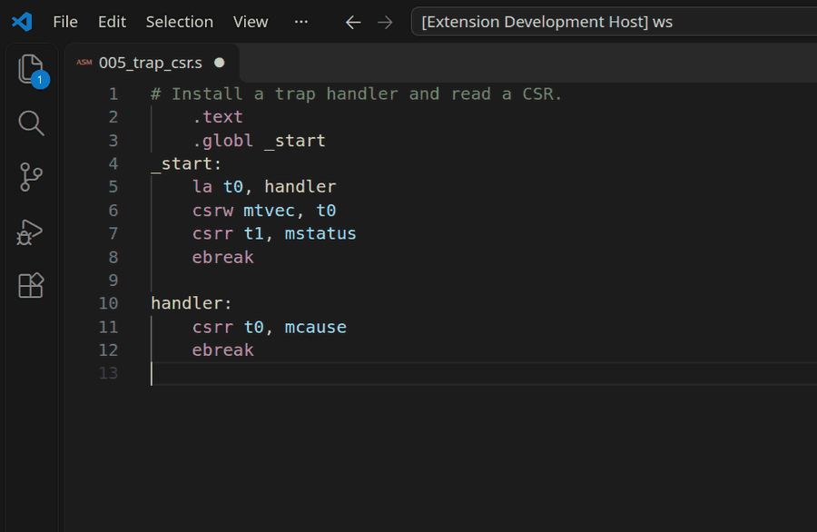
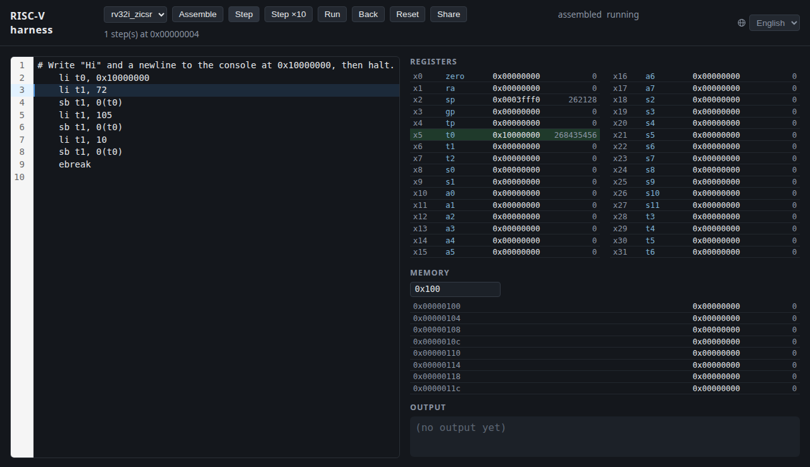

# Using it

Three front ends share one core: the `rvh` CLI, the language server and debug
adapter that editors speak to, and the browser playground.

## CLI

```bash
rvh isa lookup addi                  # encoding, operands, class
rvh isa list --ext m                 # every M instruction
rvh isa decode 0x00150513            # word to mnemonic
rvh parse prog.s --tree              # the lossless CST
rvh asm prog.s --symbols             # words, symbols, per-section layout
rvh asm prog.s --elf out.elf         # ELF32 executable
rvh run prog.s                       # assemble and run
rvh run prog.elf                     # detect `\x7fELF` and run it
rvh hover prog.s 5 6 --locale zh-CN  # what the editor would show
rvh lsp                              # LSP on stdin/stdout
rvh dap                              # DAP on stdin/stdout
```

`--target` selects the ISA (`rv32i`, `rv32i_zicsr`, `rv32im`, `rv32ia`,
`rv32e`, ...), and a file overrides it with `.attribute arch` or `.option arch`
([ADR-0014](adr/0014-target-precedence.md)).

`.insn <format> ...` emits a word the assembler does not model: `r`, `i`, `s`, `b`,
`u` and `j`, with the operand order GNU `as` uses. It is the escape hatch for a
vendor instruction whose encoding is known but whose semantics are not; the
simulator runs it only when the word happens to decode as an instruction it knows.

`--target rv32id` adds the 25 RV32D instructions: `fld`/`fsd`, the same arithmetic,
sign injection, comparisons, `fclass` and conversions with a `d` suffix, and the
fused forms with `fmt` 1. The floating-point registers are 64 bits wide, so a
double fills one; a single is stored NaN-boxed in the low half (ADR-0019), which
is also the shape RV64 will use.

Floating-point state is off until a program sets `mstatus.FS`; an F or D
instruction with `FS` off traps as illegal, and using the state makes it dirty, as
on hardware:

```asm
    li t0, 0x2000
    csrw mstatus, t0
```

`--target rv32if` assembles and runs all 25 RV32F instructions: loads and stores,
the four arithmetic operations, the fused multiply-add family, `fsgnj`/`fsgnjn`/
`fsgnjx`, `fmin`/`fmax`, the three comparisons, `fclass`, the four conversions,
and both `fmv` moves. The floating
registers hold 32-bit patterns, arithmetic goes through IEEE 754 single precision,
and `fcsr` is modelled: `frm` picks the rounding mode for the conversions, `fflags`
collects the sticky exception bits (`NX`, `DZ`, `NV`), and `fflags`, `frm` and
`fcsr` are three views of one register, so `csrr`/`csrw` reach them like any other
CSR. Arithmetic still rounds to nearest even — the host's `f32` cannot round
otherwise — and that limit is stated rather than hidden.

`--target rv32ic` assembles and runs the 26 RV32C instructions: the simulator reads
two bytes first, decodes a compressed word when the low bits are not `11`, and
steps by two (ADR-0018). `009_compressed.s` declares the extension with
`.attribute arch` and runs without a flag.

`--trace` prints one line per step instead of the final summary:

```text
0x80000094 0x800012b7 x5=0x80001000
0x8000009c 0x0062a023 mem[0x80001000]=0x41
```

The line is `<pc> <word>` followed by each write: `x5=0x…`, `f0=0x…` (16 digits),
and `mem[0x…]=0x…` for consecutive bytes of one store. It is an interface: the
spike comparison reduces spike's commit log to the same shape. The halt reason
goes to stderr, so stdout holds only the trace.

`--board spike` puts RAM at `0x8000_0000`, the map spike boots with, so the same
ELF runs in both simulators. It is 1 MiB rather than spike's 2 GiB, and the
console is not shared: a program that prints is not a candidate for comparison.
A program linked for the spike map also needs `tohost` if spike is to stop.

`--board` selects the memory map: `generic` (256 KiB of RAM at 0, the console at
`0x1000_0000`, `sp` at `0x3_fff0`) or `tiny` (16 KiB, `sp` at `0x3ff0`). The
presets live in `rvh-sim`; an unknown name lists the ones that exist.

## VS Code extension

The extension starts `rvh lsp` and contributes the `rvh` debug type.

| setting | meaning |
| --- | --- |
| `rvh.serverPath` | path to the `rvh` binary; defaults to `rvh` on `PATH` |
| `rvh.target` | workspace default ISA |
| `rvh.logLevel` | `quiet`, `normal` or `verbose` for the language server log |



The status bar shows the target the current file is analysed as. Click it, or run
**RISC-V: Select target for this file**, to pin a target to one document; a pin
wins over the workspace setting, and a file that declares its own target wins over
both.

Debugging: open a `.s` file, set breakpoints in the gutter, press F5 and pick
**Debug this file**. The debug sidebar carries a **Memory** view that follows `sp`
or `pc`, marks the rows with `↓` and `▶`, and highlights bytes that changed since
the last stop. `next` executes one instruction; `ebreak` or `ecall` ends the
session as a deliberate pause, not an exception.

### Working on the extension

`.vscode/launch.json` carries three configurations:

- **Run Extension (debug server)** builds the server and the extension, opens the
  Extension Development Host on `tests/corpus`, and points `RVH_LSP_SERVER` at
  `target/debug/rvh`;
- **Run Extension (release server)** does the same with the release binary;
- **Attach to rvh lsp** attaches to the server process; it needs CodeLLDB.

`RVH_LSP_SERVER` wins over `rvh.serverPath`, so debugging never depends on user
configuration. `preLaunchTask` runs `build: all`.

```bash
pnpm --dir editors/vscode run check     # tsc --noEmit
pnpm --dir editors/vscode run package   # writes risc-v-harness-vscode-<version>.vsix
```

## Playground

The playground is deployed at <https://trislu.github.io/risc-v-harness/>; it needs
no install and no account. To run the same page from a checkout:

```bash
pnpm install
pnpm wasm        # build the wasm into web/public/
pnpm dev         # http://localhost:5173
```

The header carries a target picker: switching from `rv32i_zicsr` to `rv32im` turns
a rejected `mul` into an accepted one, because the page starts a new session with
the same source. The page is a demo, not a second IDE
([ADR-0016](adr/0016-playground-is-a-demo-surface.md)): no breakpoints, no call
stack, no course.



The page has an editor, registers, memory, console output and diagnostics with
one-click fixes. It highlights the line the machine will run next and follows
step, run and undo. The README animation is recorded from this page by
`RVH_RECORD=1 pnpm --dir web run test:e2e -- -g "record the README demo"`.

## Corpus

`tests/corpus/` holds one file per idea, numbered as a reading order. Files from
`900_` up are deliberately broken and exercise diagnostics.

| number | file | teaches |
| --- | --- | --- |
| 000 | [000_hello_mmio.s](../tests/corpus/000_hello_mmio.s) | console output through MMIO |
| 001 | [001_loop_sum.s](../tests/corpus/001_loop_sum.s) | loops and branches |
| 002 | [002_factorial.s](../tests/corpus/002_factorial.s) | recursion and the stack |
| 003 | [003_numeric_labels.s](../tests/corpus/003_numeric_labels.s) | local numeric labels |
| 004 | [004_directives.s](../tests/corpus/004_directives.s) | sections, data, alignment |
| 005 | [005_trap_csr.s](../tests/corpus/005_trap_csr.s) | CSRs and a trap handler |
| 006 | [006_arch_directives.s](../tests/corpus/006_arch_directives.s) | `.option arch, +m` |
| 007 | [007_arch_attribute.s](../tests/corpus/007_arch_attribute.s) | `.attribute arch` |
| 008 | [008_rv32e.s](../tests/corpus/008_rv32e.s) | the embedded base |
| 009 | [009_compressed.s](../tests/corpus/009_compressed.s) | the compressed extension |
| 010 | [010_float.s](../tests/corpus/010_float.s) | floating point registers |
| 011 | [011_double.s](../tests/corpus/011_double.s) | double precision registers |

`tests/corpus/README.md` records the numbering rules.

## Content and locales

Short descriptions live in `content/overlay/<locale>/<kind>.toml`; codegen compiles
them into `rvh-content`. Lookup falls back to English key by key, so a translation
can land one line at a time.

```bash
cargo run -p rvh-cli -- hover tests/corpus/001_loop_sum.s 5 6 --locale zh-CN
```
