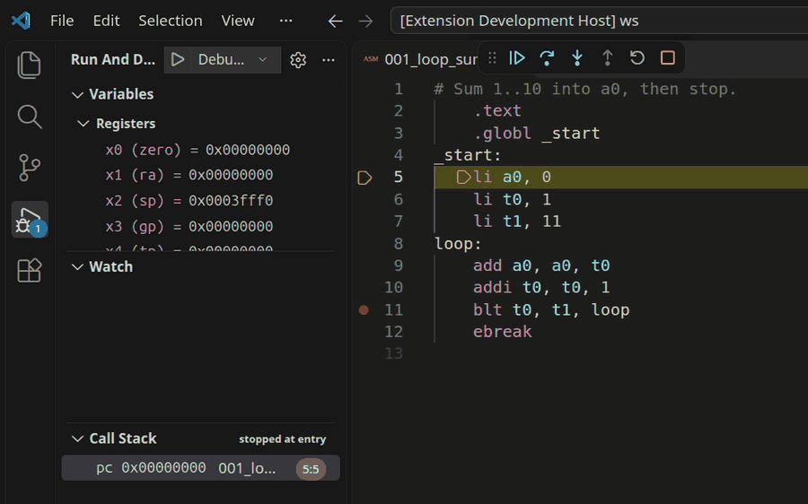

# RISC-V harness

RISC-V assembly in VS Code: hover, diagnostics with quick fixes, completion and
go-to-definition from a language server that shares its parser with the
simulator, plus a debugger that steps one instruction at a time with registers
and memory on screen.

## Features

- diagnostics and quick fixes from the same pipeline as the playground and the CLI
- hover on instructions, pseudos, registers, CSRs, labels and directives
- completion with a candidate set chosen by position
- go-to-definition and semantic highlighting from the CST
- a debug type `rvh`: breakpoints, F5 on the current file, one instruction per `next`
- a **Memory** view that follows `sp` or `pc` and highlights the bytes a step changed
- per-file ISA pins, so one workspace can mix `rv32i`, `rv32im` and `rv32ia`

## In action

A missing extension is a diagnostic, and the fix inserts the directive that
enables it.

Completion is filtered by position, and the accepted line assembles.

A workspace can mix ISAs: the target is pinned per file from the command palette.

The extension ships the `rvh` binary for its own platform and architecture, so
there is nothing else to install.

Settings, troubleshooting and build steps:
[docs/usage.md](https://github.com/trislu/risc-v-harness/blob/master/docs/usage.md#vs-code-extension).

## License

MIT OR Apache-2.0, at your option. See
[LICENSE.md](https://github.com/trislu/risc-v-harness/blob/master/editors/vscode/LICENSE.md).
